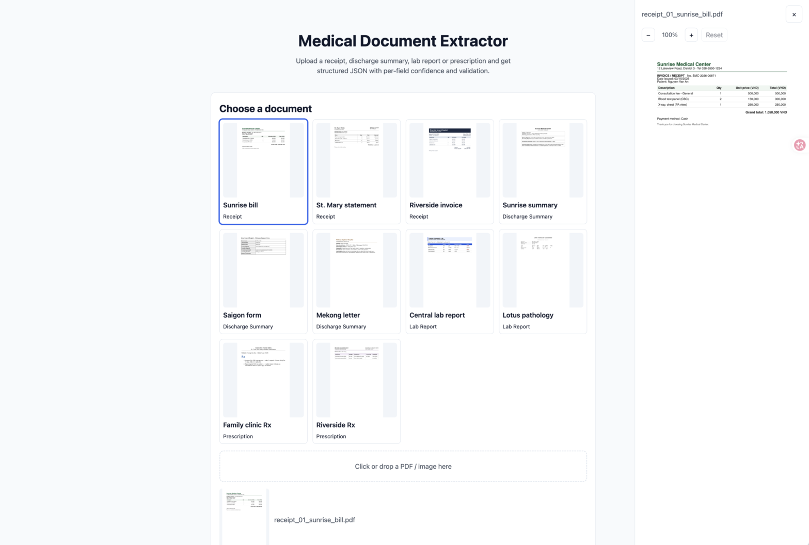

# Medical Document Extractor



A pipeline that takes a medical document (PDF or image), classifies it, extracts its fields with a vision LLM, and validates the result with deterministic code. Output is structured JSON with a confidence score for every field.

Supported types: `receipt`, `discharge_summary`, `lab_report`, `prescription`.

## Prompt engineering

### Prompt structure

Two LLM calls per document, both using the same OpenAI-compatible vision model with `temperature: 0`:

1. **Classification** (`CLASSIFY_SYSTEM` in `server/src/prompts.ts`). Returns `document_type` and `confidence`. The prompt defines each type by its purpose and layout, sets a rule for documents that look like two types (use the primary purpose; a bill that lists medicines is still a receipt), and maps confidence ranges to visual evidence.
2. **Extraction** (`extractSystem(type)`). The prompt is built per type from three parts:
   - A type-specific hint (for example: "grand_total is the final amount payable, not the subtotal").
   - Nine hard rules: never invent, copy text verbatim, normalize dates to `YYYY-MM-DD`, plain numbers, include every row, lab-flag derivation, list items hold only their own text, dosage means strength per unit, and re-read every digit.
   - A per-field confidence scale and three few-shot examples.

The JSON Schema for the expected output is generated from the Zod schemas in `server/src/schemas.ts` and appended to the system prompt. JSON mode is used because the target provider does not support `json_schema`, so the model must see the schema in the prompt. Response shape is validated again with Zod.

Pages are rendered from PDF at 2x scale (`RENDER_SCALE` in `server/src/render.ts`) and sent as PNG images, up to `MAX_PAGES` pages.

### Handling null

- The prompt instructs the model to return `value: null` with confidence `0.0` for any field not visible on the document. It never fills a field from context.
- Code enforces this too. In `server/src/pipeline.ts`, any empty value (null, blank string, empty list) is set to `null` and its confidence is capped at **0.2**, even if the model reported a higher score.
- Null list entries are allowed for partly unreadable rows: readable parts are kept and unreadable parts are null.

### Confidence

Confidence is the model's self-reported score per field, shaped by the prompt and then adjusted by code:

- **Prompt bands.** 0.85–0.92 for clearly printed text (the normal score), 0.93–0.95 only when there is no doubt, 0.70–0.84 when normalization was needed (date format, number format, derived flag), 0.40–0.69 for partly illegible text, 0.10–0.39 for values guessed from context, 0.00 for null. The prompt says not to go above 0.95.
- **Rule caps.** Ambiguous dates are capped at 0.60. Lab flags derived from a range are capped at 0.85. Null values are capped at 0.2.
- **Validation penalty.** A field that fails validation is set to `null` and capped at **0.1** (`server/src/validate.ts`).
- **Document confidence.** The classification confidence from the first call. Bands: 0.90–1.00 for an unmistakable layout, 0.60–0.85 for mixed features, below 0.50 for blurry or partial pages.

The goal is that confidence separates readable fields from uncertain ones. The eval checks this with the share of fields above 0.9 and the mean score per expected band.

### Iterations and results

Full notes are in `mock/samples/results/prompt-iterations.md`. Results on the 10 sample documents:

| Round | Change | Classification | Correct / wrong / hallucinated / missing | Share of fields > 0.9 | Mean score: high / medium / low band |
|---|---|---|---|---|---|
| v1 (baseline) | Original prompt | 10/10 | 151 / 5 / 0 / 0 | 84.5% | 0.949 / 0.767 / 0.033 |
| v2 | Lower confidence scale, example 0.97 → 0.9, rules on dates in item names, dosage, and re-reading digits | 10/10 | 151 / 5 / 0 / 0 | 29.3% | 0.902 / 0.767 / 0.033 |
| v3 | More specific dosage rule with a generic example (not taken from the samples) | 10/10 | **154 / 2** / 0 / 0 | 36.2% | 0.906 / 0.783 / 0.033 |

What each round fixed:

- **v1 → v2 (calibration).** The baseline scored 84.5% of fields above 0.9, which is too confident for a field-level signal. Lowering the scale brought this to 29.3%.
- **v2 → v3 (accuracy).** Dosage was taken as units per dose (`1 capsule`) instead of strength (`500 mg`). A specific rule with a generic example fixed both prescription errors.
- **Grading change.** Honorific prefixes (`Dr.`, `BS.`, `TS.`) are ignored when matching names. The expected file had omitted them, which was a grading error and not a model error. The change moved v1 from 149 to 151 correct, with no model change.

Remaining errors in v3 are one misread digit (`430` read as `439`, in a receipt total of a line item) and one frequency with extra text that the answer key cut short. The digit error passes validation because the total is still within the 5% tolerance.

### Validation (deterministic)

Implemented in `server/src/validate.ts`:

- Dates must be real calendar dates (leap years checked). Invalid dates are flagged as `invalid_date`.
- For discharge summaries, the discharge date must not be before the admission date.
- Amounts (`grand_total`, item `unit_price` and `total`) must be positive. Invalid values are flagged as `invalid_amount`.
- For receipts, `quantity × unit_price` must equal `total` within 1%. Mismatches are flagged as `item_arithmetic`.
- For receipts, the sum of item totals must be within 5% of `grand_total`. Larger differences are flagged as `amount_mismatch`.

### Limitations

- The prompt was tuned on the 10 sample documents. The two extra documents in `mock/external/` are a weak check on generalization, not a blind test set.
- Accuracy is measured on one run per round. Output varies between runs, so small score changes are not conclusive.
- Confidence is self-reported by the model. It is useful for ranking uncertain fields but is not a calibrated probability.

## Setup and run

Requirements: [Bun](https://bun.com) and an API key for an OpenAI-compatible vision model.

### Server

```bash
cd server
bun install
cp .env.example .env   # then set LLM_API_KEY, LLM_BASE_URL, LLM_MODEL
bun run index.ts       # listens on PORT (default 3000)
```

`.env` variables:

| Variable | Description |
|---|---|
| `LLM_API_KEY` | API key for the provider |
| `LLM_BASE_URL` | OpenAI-compatible endpoint, for example `https://api.deepseek.com` |
| `LLM_MODEL` | Model with image input support |
| `PORT` | Server port (default `3000`) |
| `MAX_PAGES` | Maximum PDF pages per document (default `10`) |

Extract a document:

```bash
curl -F "file=@mock/samples/receipt_01_sunrise_bill.pdf" http://localhost:3000/api/extract
```

### Web app

```bash
cd app
bun install
bun run dev            # Vite dev server; proxies /api to localhost:3000
```

Other scripts: `bun run build` (type-check and build), `bun run lint` (oxlint).

### Tests and evaluation

```bash
cd server
bun test                                  # unit and pipeline tests
bun run scripts/eval.ts                   # run the pipeline on the 10 samples and score them
EVAL_SCORE_ONLY=1 bun run scripts/eval.ts ../mock/samples ../mock/samples/results/iterations/v3   # re-score saved output, no LLM calls
```

The eval writes per-document JSON and a `report.json` (classification accuracy, leaf verdicts, confidence bands, and validation checks).

## Project structure

```
.
├── CHALLENGE_08.md          # Problem spec
├── CLAUDE.md                # Guidance for Claude Code
├── app/                     # React + Vite web UI (upload, preview, results)
│   ├── src/components/      # Upload, preview, result table, validation list
│   ├── src/lib/             # API client, PDF helpers, confidence levels, sample loader
│   └── public/samples/      # The 10 sample PDFs served to the UI
├── server/                  # Bun HTTP API and extraction pipeline
│   ├── index.ts             # Bun.serve entry, POST /api/extract
│   ├── src/config.ts        # Environment configuration
│   ├── src/render.ts        # PDF and image input → page PNGs
│   ├── src/llm.ts           # Classification and extraction calls
│   ├── src/prompts.ts       # Prompt text and per-type hints
│   ├── src/schemas.ts       # Zod schemas for each document type
│   ├── src/validate.ts      # Deterministic validation rules
│   ├── src/pipeline.ts      # Orchestration and null/confidence rules
│   ├── src/grading.ts       # Scoring against expected answers
│   ├── scripts/eval.ts      # Evaluation runner
│   ├── scripts/make-external.ts  # Draws the extra external test documents
│   └── tests/               # bun test suites
└── mock/
    ├── samples/             # 10 mock documents (HTML + PDF), expected.json
    │   └── results/         # Extraction output per document
    │       ├── iterations/  # v1–v3 outputs and reports
    │       └── prompt-iterations.md
    └── external/            # 2 extra documents (PNG) for generalization checks
```
